# PDZDH CalcuTool

三相交流计算分析工具 —— Windows 桌面版（WinForm） + Android 版

输入三相电压电流后计算各合成分量与序分量以及功率值，并绘制相量图。支持中英界面切换（默认中文）。

## Windows 桌面版

由Claude Code Opus 4.6模型完全生成，输入三相电压电流后计算各合成分量与序分量以及功率值

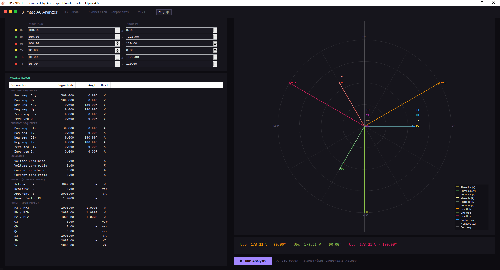

支持中英界面语言切换

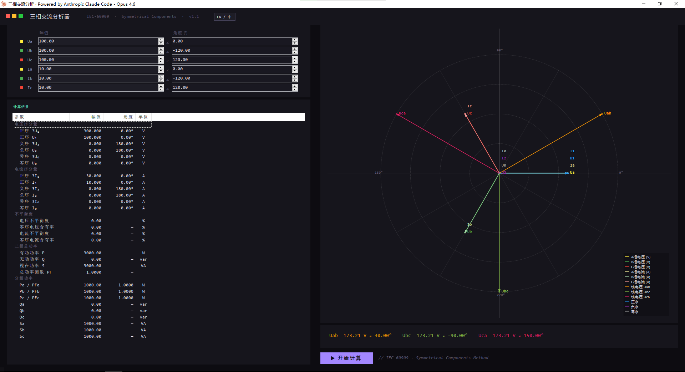

## Android 版：配电工具箱

把三个现场小工具装进一个 App（`android/`，分支 `android`），纯 Framework + Java，
无 Gradle / AndroidX 依赖，APK 约 420 KB。首页平铺进入：

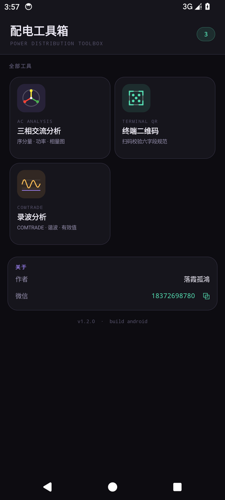

| 工具 | 说明 |
|---|---|
| 三相交流分析 | 桌面版算法与配色的完整移植 |
| 终端二维码 | 相机扫码 + 六字段规范校验 |
| 录波分析 | COMTRADE 波形：缩放/滚动/游标/上下峰值/一次二次值/谐波/向量/小电流接地判别 |

| 输入与相量图 | 计算结果 |
|---|---|
| 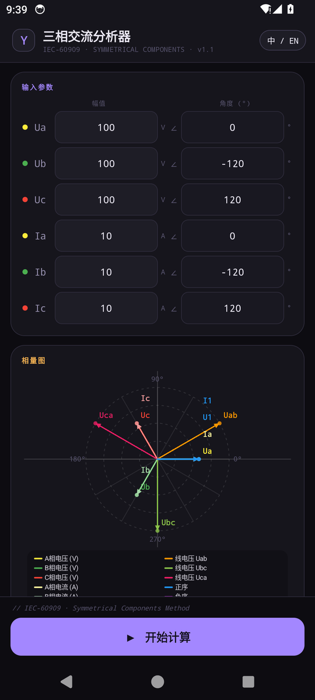 | 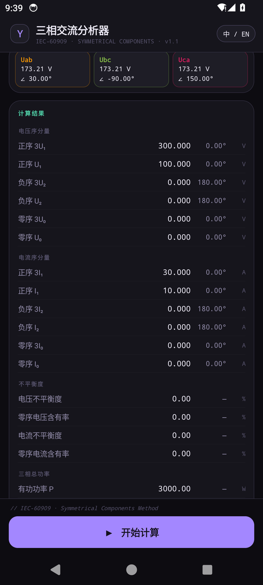 |

英文界面：

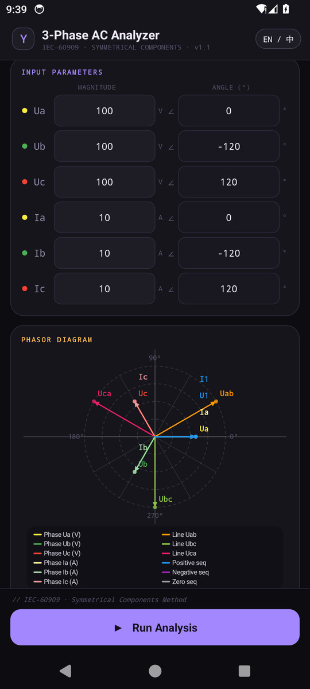

### 终端二维码识别

相机扫码读取配电终端二维码，校验六字段后弹窗显示字段定义与内容；
只接受中文冒号「：」与中文逗号「，」，空格和英文标点一律拦截并提示位置。

| 校验通过 | 校验未通过 |
|---|---|
| 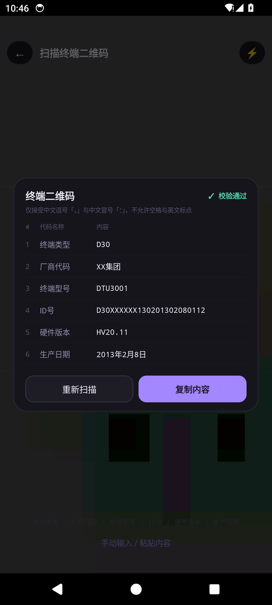 | 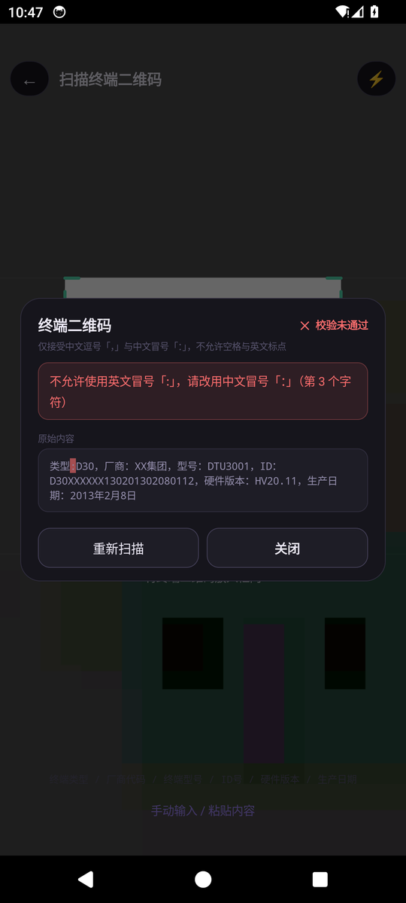 |

### 录波分析（COMTRADE）

| 数值 / 有效值 | 谐波 | 小电流接地判别 |
|---|---|---|
| 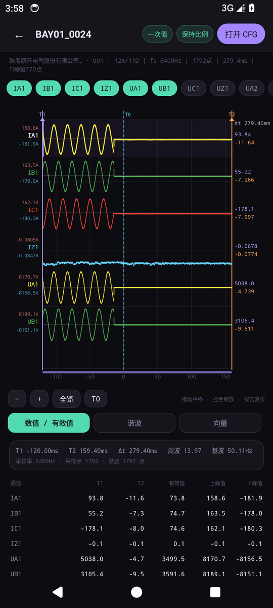 | 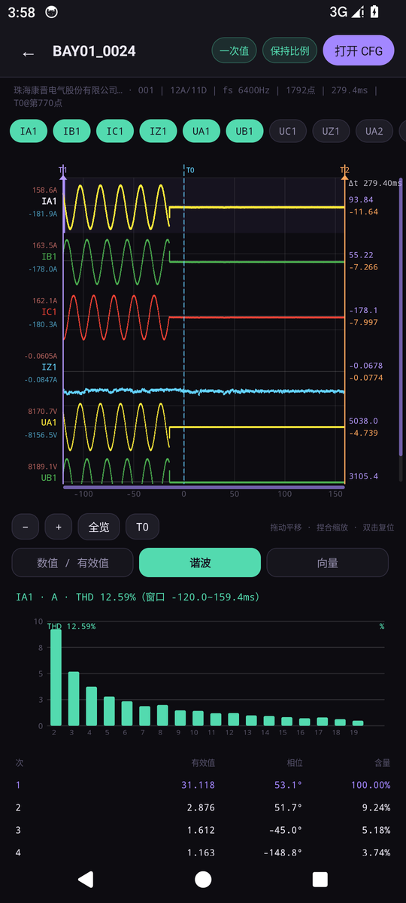 | 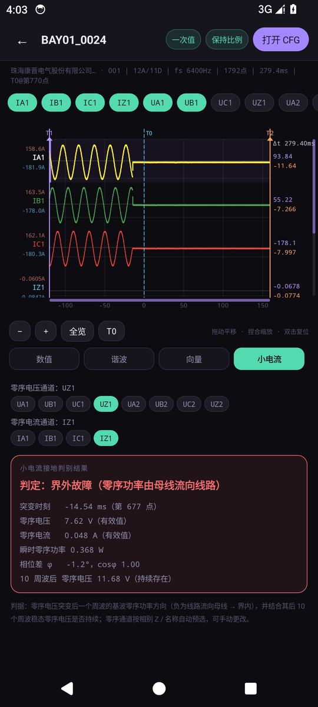 |

支持 1991/1999/2013、ASCII/BINARY/BINARY32/FLOAT32，自动在同目录读取同名 dat；
提供横纵滚动条、通道显隐、T1/T2 游标拖动与 Δt、上下峰值、一次/二次值切换、
保持比例与填充绘制切换，以及谐波（1~19 次 + THD）、基波向量、小电流接地方向判别。

### 安装

直接安装 `android/PDZDH-Toolbox-1.2.apk`（Android 7.0 / API 24 及以上）。

### 重新构建

```bash
export JAVA_HOME=<JDK 17+>
export ANDROID_HOME=<Android SDK，需 build-tools 34.0.0 与 platform android-34>
cd android && ./build.sh
```

详见 [android/README.md](android/README.md)。

## 作者

- 落霞孤鴻
- 微信：18372698780（Android 版「关于」卡片可点击复制）
