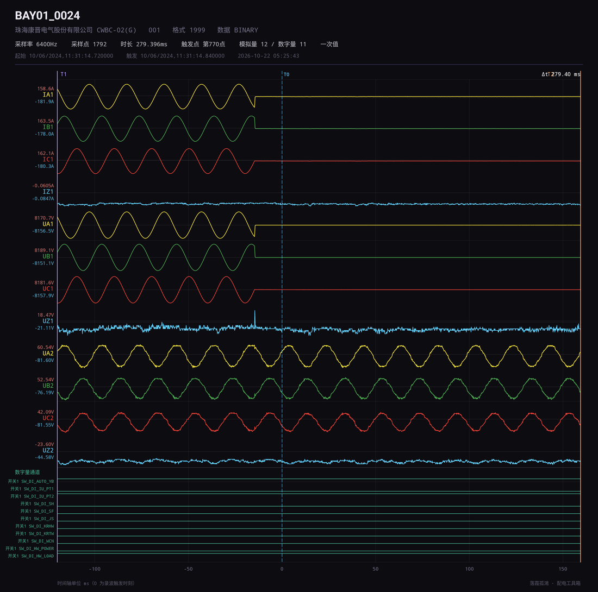
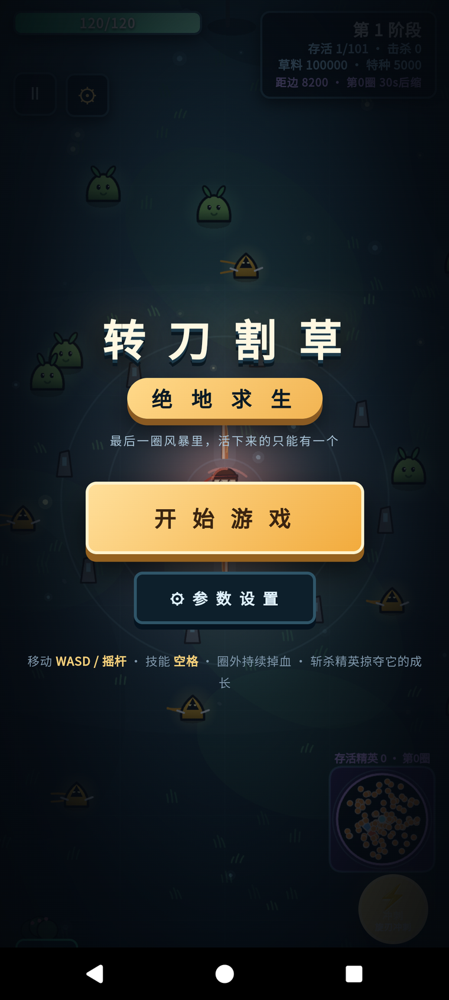
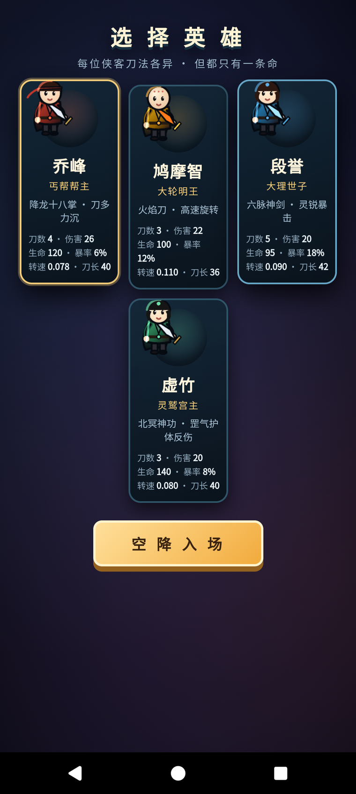

# 配电工具箱 · Android

把几个配电现场常用的小工具装进一个 App，首页平铺进入。纯 Framework + Java，
不依赖 Gradle / AndroidX / Kotlin，APK 约 540 KB。


| 工具 | 说明 |
|---|---|
| 三相交流分析 | 序分量、不平衡度、功率、线电压、相量图（桌面版 WinForm 的移植） |
| 终端二维码 | 相机扫码，按六字段规范校验后弹窗显示字段与内容 |
| 录波分析 | COMTRADE 波形查看与分析：有效值、上下峰值、谐波、向量、小电流接地判别 |
| 转刀割草 | 绝地求生风格的小游戏（HTML5 Canvas，WebView 承载），换换脑子用 |

## 1. 三相交流分析

同一套算法与配色，默认中文界面，可切换英文（记忆上次选择）。

| 输入与相量图 | 计算结果 |
|---|---|
|  |  |


## 2. 终端二维码

相机扫码读取配电终端二维码，校验后弹窗展示六字段。

| 校验通过 | 校验未通过 |
|---|---|
|  |  |

### 扫码方式

| 入口 | 说明 |
|---|---|
| 相机 | 实时取景，中心 74% 区域解码，支持补光与连续对焦 |
| 相册 | 右上「相册」选本地图片（截图、照片、聊天里存的图），自动正片/反相各解一次，黑底白码也能读 |
| 手动输入 | 二维码破损或相机不可用时的兜底，可粘贴 |

### 中文编码自适应

二维码里存的是字节流，国产工具的生成器常按 GB18030/GBK 编码，微信里转存的图又可能是 UTF-8。
解码流程：ZXing 取**字节段** → 按 UTF-8 / GB18030 / BIG5 各自**严格解码** → 用字符分布打分
（中文标点与常用汉字加分，替换符 `�`、拉丁扩展乱码、私用区字符扣分，能通过六字段校验的直接判优）→ 取最高分。

弹窗里会标出实际采用的编码，如「编码 GB18030（已自动纠正）」，便于现场判断二维码本身是否规范。

### 内容规范

六个字段，键值之间用**中文冒号**「：」，字段之间用**中文逗号**「，」：

```
类型：D30，厂商：XX集团，型号：DTU3001，ID：D30XXXXXX130201302080112，硬件版本：HV20.11，生产日期：2013年2月8日
```

| 序号 | 字段 | 说明 |
|---|---|---|
| 1 | 终端类型 | 如 D30 |
| 2 | 厂商代码 | 如 XX集团 |
| 3 | 终端型号 | 如 DTU3001 |
| 4 | ID号 | 6~40 位字母/数字/`-`/`_`/`/` |
| 5 | 硬件版本 | 如 HV20.11 |
| 6 | 生产日期 | `YYYY年M月D日` |

校验规则：不允许空格（含全角/制表符/换行）、英文逗号 `,`、英文冒号 `:`、英文分号 `;`；
字段数量必须为 6，字段名需在定义内且不可重复/缺失；ID号、硬件版本、生产日期需符合上表格式。
示例二维码见 `picture/qr-example.png`。

## 3. 录波分析（COMTRADE）

读数、分析与 CAAP2008X 的主要操作对齐。支持 COMTRADE 1991/1999/2013，
数据格式 ASCII / BINARY / BINARY32 / FLOAT32，cfg 编码 UTF-8 与 GB18030 自动识别。

| 数值 / 有效值 | 谐波 |
|---|---|
|  |  |

| 小电流接地判别 |
|---|
|  |

### 打开方式

- 「打开 CFG」选择 `.cfg`，自动在**同目录**找同名 `.dat`
- 若系统未授予目录权限（Android 只授权单个文件），会提示「授权文件夹」，
  授权一次后即可按名字自动匹配（递归 3 层）；也可直接手动选择 `.dat`
- 「加载示例录波」内置一组样例，可直接体验
- 点通道芯片开关模拟量通道（默认前 6 个），「DI 数字量」开关数字量通道

### 波形操作

| 操作 | 说明 |
|---|---|
| 单指左右拖 | 时间轴平移 |
| 单指上下拖 | 通道上下滚动（通道多时） |
| 捏合 | 时间轴缩放 |
| 点通道 | 选中该通道（谐波/向量的分析对象） |
| 拖 T1 / T2 竖线 | 移动游标，右侧瞬时值与 Δt 实时更新 |
| 横向滚动条 | 拖动定位时间窗口 |
| 纵向滚动条 | 拖动浏览所有通道 |
| 全览 | 复位时间窗口并把 T1/T2 归位 |
| 导出 | 生成整段录波的全景高清 PNG（见下） |

- 通道左侧显示**上峰值**（标识上方）与**下峰值**（标识下方），右侧显示 T1/T2 瞬时值
- 顶部「Δt」显示 T1→T2 时间差，同时下方读数栏给出周波数与等效基波频率
- 顶部「一次值 / 二次值」切换显示口径（按 cfg 的 primary/secondary 变比换算）
- 顶部「保持比例 / 填充绘制」切换：保持比例时每道固定高度可滚动，填充绘制时压缩塞满绘制区
- 相别配色：A 黄、B 绿、C 红，零序等其它通道为青色

### 导出全景图

点「导出」选择保存位置，文件名 `shot_<波形文件名>.png`，内容为：

- 宽 2400px 的高清长图，包含厂家/装置/格式/采样率/点数/时长/触发点/一次二次标注
- **全部**模拟量通道 + **全部**数字量通道（不受当前显隐影响），每道上/下峰值
- T0/T1/T2 时标与 Δt、时间轴刻度（单位 ms，0 为触发时刻）



### 分析页

| 页 | 内容 |
|---|---|
| 数值 | 各通道 T1/T2 瞬时值、窗口真有效值、上/下峰值；游标摘要含 Δt、周波数、基波频率 |
| 谐波 | 1~19 次谐波有效值、相位、含量百分比 + 柱状图 + THD（基波过小时给出提示） |
| 向量 | 基波相量图（电压/电流分组归一化，电流虚线）与幅值/相位/相对角表 |
| 小电流 | 零序接地方向判别，见下 |

### 小电流接地判别

选零序电压通道与零序电流通道（按相别 Z / 名称自动预选，可改），按三步判定：

1. **突变时刻**：滑窗真有效值相对基线的跃变（退化时取最大斜率点）
2. **零序功率方向**：突变后**首半波**的瞬时功率积分 `P0 = (1/T½)·∫u0·i0 dt`
3. **稳态**：突变后第 10 个周波起的零序电压是否仍持续存在

| 条件 | 结论 |
|---|---|
| `P0 < 0`（首半波功率由线路流向母线）且稳态零序电压存在 | 界内故障 |
| `P0 > 0`（首半波功率由母线流向线路）且稳态零序电压存在 | 界外故障 |
| 稳态零序电压已衰减 | 瞬时性接地，暂不判界内 |
| `abs(cosφ) < 0.2` | 方向不明确，建议人工复核 |

方向判据的正负与 PT/CT 极性有关；若现场接线使符号相反，需按现场约定对调结论。

## 4. 转刀割草（小游戏）

内置的 HTML5 Canvas 小游戏，全屏 WebView 承载（`assets/game/zhuan-dao-gecao.html`），
按**默认竖版**加载，画布自适应窗口比例。

| 开始界面 | 选择英雄 |
|---|---|
|  |  |

- 四名侠客刀法各异（刀数 / 伤害 / 生命 / 暴击 / 转速 / 刀长），选好点「空降入场」
- 全屏无状态栏、常亮不息屏；左下角「退出」或返回键回到工具箱
- 硬件层渲染（`LAYER_TYPE_HARDWARE`），保证 canvas 刷新顺滑

## 权限说明

| 权限 | 用途 |
|---|---|
| `READ_EXTERNAL_STORAGE`（≤ Android 12） | 读取用户选择的 COMTRADE 录波与导出 PNG |
| `MANAGE_EXTERNAL_STORAGE`（Android 11+） | 「所有文件访问」，用于在 cfg 同目录自动匹配同名 dat、递归查找；不授予时退化为手动选择 dat |
| `WRITE_EXTERNAL_STORAGE`（≤ Android 9） | 导出的全景图写入所选目录 |
| `CAMERA` | 终端二维码扫码 |

录波页顶部有权限条，未授权时点击即可跳转系统设置逐项开启；同时支持 SAF 目录授权，
不依赖「所有文件访问」也能按名字匹配 dat。

## 构建

```bash
export JAVA_HOME=<JDK 17+>
export ANDROID_HOME=<Android SDK，需 build-tools 34.0.0 与 platform android-34>
./build.sh
# -> android/PDZDH-Toolbox-1.2.apk
```

流水线：`aapt2 compile → aapt2 link（含 assets）→ javac → d8 → zipalign → apksigner`。

依赖：二维码解码用 ZXing core（`libs/core-3.5.3.jar`，随仓库提交，离线可构建）。
签名：`keystore/pdzdh-release.jks`（口令 `android`，别名 `androiddebugkey`）。

编译参数注意：`javac --release 8 -parameters`。`-parameters` 是必需的，
d8 8.2.x 解析到无参数名的 `MethodParameters` 属性会抛 NPE。

## 校验

- 计算核心与桌面算法逐项对齐：3 组随机工况（幅值/相位/功率，误差 < 1e-4）
- 二维码：ZXing 同一代码路径在 JVM 上对中文二维码 PNG 做 NV21 + 中心裁剪解码，
  再走 `QrTerminalParser`；覆盖通过/空格/英文逗号/英文冒号/缺项/格式错误
- 二维码编码与图片路径（`tests/run.sh`，纯 JVM，不需模拟器）：
  UTF-8 / GB18030 / GBK / ASCII 生成-解码往返 5 例全对；人为把 GB18030 与 BIG5 字节按 UTF-8 解成乱码后，
  兜底层分别纠正为 `GB18030`、`BIG5`；白底图与黑底反相图均识别成功
- COMTRADE：对 `COMTRADE/` 下的样例校验通道数、采样率、时间轴
  （内置示例 `BAY01_0001_20260610204052_305`：12800 Hz、3585 点、约 280 ms、T0 在第 1281 点），
  并与独立 Python 实现核对基波/谐波/RMS
- 模拟器（Pixel 6 / Android 14）实机走查：工具箱入口、相机权限与扫码、录波加载、缩放/滚动、
  游标拖动与 Δt、一次/二次切换、谐波与向量、小电流判别、全景导出、小游戏启动

## 图标

`tools/gen_icon.py` 生成自适应图标：深蓝底 + 网格 + 白色工具箱 + 国网绿闪电 + 南网蓝底座
（108dp 矢量前景 + 5 档密度 PNG + 圆形变体），预览 `icon/icon-512.png`。
首页各工具的图形由 `ToolGlyph` 直接 Canvas 绘制，新加工具只要在枚举里补一个字形。

## 作者

- 落霞孤鴻
- 微信：18372698780（首页「关于」点击复制）
