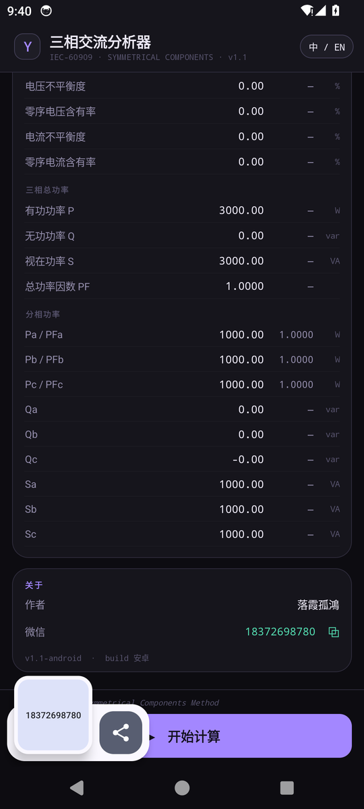

# 三相交流分析 · Android

桌面版（WinForm / `main.cs`）的安卓移植，业务算法、界面语言与配色保持一致。
默认中文界面，可切换英文（记忆上次选择）。

| 输入与相量图 | 计算结果 | 关于 |
|---|---|---|
|  |  |  |


## 终端二维码识别

相机扫码读取配电终端二维码，按规范校验后弹窗展示字段定义与内容。

| 校验通过 | 校验未通过 |
|---|---|
|  |  |

示例二维码（可用手机扫码自测）：


### 内容规范

六个字段，键值之间用**中文冒号**「：」，字段之间用**中文逗号**「，」：

```
类型：D30，厂商：XX集团，型号：DTU3001，ID：D30XXXXXX130201302080112，硬件版本：HV20.11，生产日期：2013年2月8日
```

| 序号 | 字段 | 说明 |
|---|---|---|
| 1 | 终端类型 | 如 D30 |
| 2 | 厂商代码 | 如 XX集团 |
| 3 | 终端型号 | 如 DTU3001 |
| 4 | ID号 | 6~40 位字母/数字/`-`/`_`/`/` |
| 5 | 硬件版本 | 如 HV20.11 |
| 6 | 生产日期 | `YYYY年M月D日` |

校验规则（任一不满足即弹窗说明原因，并在原始内容中高亮违规字符）：

- 不允许空格（含全角空格、制表符、换行）
- 不允许英文逗号 `,`、英文冒号 `:`、英文分号 `;`
- 字段数量必须为 6，字段名需在定义内，不可重复、不可缺项
- `ID号`、`硬件版本`、`生产日期` 需符合上述格式

字段名同时接受简称（类型/厂商/型号/ID/硬件版本/生产日期）与规范全称
（终端类型/厂商代码/终端型号/ID号/硬件版本/生产日期）。

除相机扫码外还支持：其它应用「分享 → 三相交流分析」把文本直接送来校验；
相机不可用或二维码破损时，扫码页可「手动输入 / 粘贴内容」。

实现：`QrTerminalParser`（纯 Java 校验，可单测）+ `ScanActivity`（Camera + ZXing）+ `ScanOverlayView`（取景框）。

## 功能对照

| 桌面版 | Android 版 | 实现位置 |
|---|---|---|
| 三相电压/电流输入（幅值 + 相对角） | 同 | `MainActivity.paramRow` |
| 序分量 3U₁/U₁ · 3U₂/U₂ · 3U₀/U₀ | 同 | `PhasorCalc.sequence` |
| 不平衡度 / 零序含有率 | 同 | `PhasorCalc.compute` |
| 三相总功率 P/Q/S/PF、分相功率 | 同 | `PhasorCalc.compute` |
| 线电压 Uab/Ubc/Uca | 同（标签 + 相量） | `MainActivity.updateChips` |
| 相量图（同心圆、30° 刻度、电流 ×10 缩放、标签避让、图例） | 同 | `PhasorView` |
| EN / 中 界面切换 | 同，默认中文 | `Lang` |
| 输入变化即时刷新相量图 | 同 | `MainActivity.updateChartOnly` |
| — | 终端二维码识别与校验 | `ScanActivity` / `QrTerminalParser` |

## 构建

不依赖 Gradle / AndroidX / Kotlin，纯 Framework + Java；二维码解码用 ZXing core
（`libs/core-3.5.3.jar`，随仓库提交，离线可构建）。

```bash
export JAVA_HOME=<JDK 17+>
export ANDROID_HOME=<Android SDK，需 build-tools 34.0.0 与 platform android-34>
./build.sh
# -> android/PDZDH-CalcuTool-1.1.apk
```

流水线：`aapt2 compile → aapt2 link → javac → d8 → zipalign → apksigner`。

签名：`keystore/pdzdh-release.jks`（口令 `android`，别名 `androiddebugkey`）随仓库提交，
保证升级安装签名一致；仓库内缺失时 `build.sh` 会自动生成。

编译参数注意：`javac --release 8 -parameters`。`-parameters` 是必需的，
d8 8.2.x 解析到无参数名的 `MethodParameters` 属性会抛 NPE。

## 校验

- 计算核心与桌面算法逐项对齐：3 组随机工况（幅值/相位/功率，误差 < 1e-4）交叉验证
- 扫码链路：用同一份 ZXing 代码在 JVM 上把中文二维码 PNG 转成 NV21 + 中心裁剪后解码，
  再走 `QrTerminalParser`；用例覆盖通过 / 空格 / 英文逗号 / 英文冒号 / 缺项 / 格式错误
- 已在 Pixel 6 / Android 14 模拟器跑通：相机权限申请、实时预览、扫码弹窗、手动输入、分享文本校验

## 图标

`tools/gen_icon.py` 生成自适应图标（108dp 矢量前景 + 5 档密度 PNG + 圆形变体）：

- 设计：深紫径向渐变底 + 三相相量（A 黄 / B 青 / C 珊瑚红，互差 120°）+ 参考圆环 + 中性点
- 与 App 内相量图同源，改设计后重跑脚本即可覆盖全部密度
- 预览：`icon/icon-512.png`

## 作者

- 落霞孤鴻
- 微信：18372698780（App 内「关于」卡片点击即复制）
